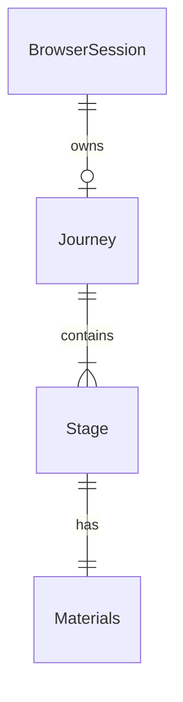

# Functional Specification — u1-skeleton

## Sources

- `unit-of-work.md` — `aidlc/spaces/default/intents/261110-learning-journey-app/inception/units-generation/unit-of-work.md`
- `unit-of-work-story-map.md` — `aidlc/spaces/default/intents/261110-learning-journey-app/inception/units-generation/unit-of-work-story-map.md`
- `stories.md` — `aidlc/spaces/default/intents/261110-learning-journey-app/inception/user-stories/stories.md`: US1.1, US1.3, US1.4, US1.5, US2.1, US2.3, US9.1, US9.2 (throttle part), US9.3
- `requirements.md` — `aidlc/spaces/default/intents/261110-learning-journey-app/inception/requirements-analysis/requirements.md`
- `components.md` — `aidlc/spaces/default/intents/261110-learning-journey-app/inception/domain-design/components.md`
- `contract-summary.md` — `aidlc/spaces/default/intents/261110-learning-journey-app/inception/contract-design/contract-summary.md`
- `entities.md` and `rules.md` in this folder
- Functional design answers Q1 to Q4 — `functional-design-questions.md` in this folder

This is the source of truth for the order of steps and for the states of a request. The data shapes are in `entities.md` and the decision rules in `rules.md`; the diagram and table at the end are derived from them. Stack settings (throttle, alerts, removal, HTTPS, permissions) are rules with no steps; they are listed at the end and designed in Infrastructure Design.

## Workflow 1 — Create a journey

Stories: US1.1, US1.3, US1.4, US1.5, US2.3. Rules: BR1.1 to BR1.6, BR2.1 to BR2.4, BR3.1 to BR3.5, BR4.1 to BR4.3, BR5.1, BR5.3, BR7.1.

1. The learner types a topic and presses "Generate my journey".
2. The browser trims the topic and checks BR1.1 and BR1.2. If either fails, it shows the message, keeps the text and stops. No request is sent.
3. The browser disables the button, announces "Generating your journey" politely, and sends `POST /api/v1/journey` with the topic and the session ID in the header. No style is sent in U1, so the guide style is used (BR6.1).
4. The server checks the session ID (BR5.3) and repeats BR1.1 and BR1.2. On failure it answers INVALID_REQUEST or TOPIC_INVALID and stops.
5. The generator starts the 15-second clock and the 18-second request cap, then reserves a daily-cap slot through the usage guard interface (BR3.5). In U1 the guard always grants; the real cap and DAILY_LIMIT arrive in U3.
6. The generator removes the delimiter from the topic and builds the model request (BR1.3, BR3.4).
7. The generator calls the model through its fakeable interface and logs the attempt with its model identifier and outcome, including a refusal (BR4.3).
8. It looks at the reply:
   - Refusal (`refused` true): go to step 14.
   - Valid journey (BR2.1 to BR2.4): go to step 11.
   - Anything else, or a failure or throttle: go to step 9.
9. If no retry has been made and at least 5 seconds of the 15 remain, go back to step 7 once with the time left (BR3.1).
10. Otherwise build the template (BR4.1) with source `template` and go to step 11.
11. The generator logs the journey's source, `ai` or `template` (BR4.3).
12. The store saves the Journey, replacing any earlier one (BR5.1). If the save fails or takes over 2 seconds, or the 18-second cap (which applies to this save phase only) is reached before the journey is saved, the generator releases the reserved slot once (BR3.5), the server answers SAVE_FAILED and the browser goes to step 16. When the save succeeds the slot is kept.
13. The server answers 201 with the Journey. The browser shows it (Workflow 2) and announces the result.
14. Refusal: the generator releases the reserved slot once (BR3.5) and the server answers TOPIC_NOT_ALLOWED. Nothing is saved and the template is not used (BR1.4). An unexpected error that ends the request with no journey also releases the slot once and answers a failure.
15. The browser shows the "try a different topic" message, keeps the typed topic and enables the button.
16. Failure path: the browser shows that the journey could not be made or saved, with "Try again". Before another attempt it asks `GET /api/v1/journey`; if a journey made in the last minute exists, it shows that one instead of sending a new request.
17. While waiting, if the wait passes 5 seconds the browser shows a reassuring message (BR6.1). If nothing arrives in 20 seconds, it goes to step 16.
18. Throttled: if the API answers RATE_LIMITED, or a 429 that carries no error code (a 429 with a code, such as DAILY_LIMIT in U3, is handled by that code), at any point, the browser shows the plain "please wait" message, keeps the typed topic, enables the button and offers to try again. This is not the failure of step 16 and no journey check is made (BR7.1).

Result states: journey shown (AI), journey shown (template), topic invalid (no request), topic not allowed, throttled, save failed, no answer. Any other server error is shown as the failure in step 16.

## Workflow 2 — Show the journey

Stories: US2.1, US2.3. Rules: BR1.5, BR4.2, BR6.2, BR6.3.

1. The browser shows the label that matches the journey's source (BR4.2), the topic, the stages in order, and the hours of each stage.
2. The learner opens a stage; the browser shows its name, what it is, why it matters, what the learner can do after it, and its reading, exercises, mini project and quiz (BR6.2). Text is plain text and wraps (BR1.5).
3. No control to mark a stage, set a goal date, choose a style, replace or delete is shown in U1 (BR6.3).

## Workflow 3 — Open the page

Rules: BR5.2, BR5.3, BR6.3, BR6.4.

1. The browser looks for a session ID. If it has none, it makes a random UUID and tries to keep it. If the browser blocks storage, it shows a clear message, offers no journey and stops (BR6.4).
2. The browser asks `GET /api/v1/journey`.
3. If a journey is returned, it is shown (Workflow 2) and no new-journey control is offered (BR6.3).
4. If nothing is returned, the home screen with the topic box is shown.
5. If the load fails (LOAD_FAILED, or no answer in 10 seconds), a short error with "Try again" is shown and the other controls stay usable (BR5.2). If the API answers RATE_LIMITED, the "please wait" message is shown instead (BR7.1). The full loading skeleton belongs to U2.

## State machine — a create request

| From | Event | To |
|---|---|---|
| Idle | Topic fails BR1.1 or BR1.2 in the browser | Idle with a message (no request) |
| Idle | Valid topic submitted | Generating |
| Generating | Reply is a refusal | Not allowed |
| Generating | Reply is valid | Saving (source `ai`) |
| Generating | Invalid, failed or throttled, 5 or more seconds left, no retry yet | Generating (retry) |
| Generating | Invalid or failed with no retry possible, or 15 seconds passed | Saving (source `template`) |
| Saving | Saved | Shown |
| Saving | Save failed or took over 2 seconds, or 18-second cap reached | Failed |
| Generating or Saving | No answer in 20 seconds in the browser | Failed |
| Any request state | API answers RATE_LIMITED | Idle with the "please wait" message (topic kept) |
| Not allowed | Learner edits the topic | Idle |
| Failed | "Try again" and no recent journey found | Generating |
| Failed | "Try again" and a journey made in the last minute exists | Shown |

## Acceptance behaviour for the stack (no steps)

- Throttle: 11 requests in the same instant, the 11th is rejected with RATE_LIMITED; 6 requests a second for 10 seconds, requests above the rate are rejected once the burst is used (BR7.1; AC9.2.1, AC9.2.4).
- Budget alerts: an alert at 2 dollars of actual spend in a day and another at 8 dollars in the month, with the email passed at deploy time (BR7.2; AC9.1.1).
- Removal: `cdk destroy` leaves no resource behind, including the table and the bucket with files in it (BR7.3; AC9.3.1, AC9.3.2).
- HTTPS and permissions: BR7.4 and BR7.5 (AC1.1.6, AC1.1.7).

## Business scenarios

| Scenario | Expected result |
|---|---|
| Valid topic, model answers in 6 seconds with 5 valid stages | AI journey shown with the AI label |
| Model returns 7 stages after 6 seconds, retry is valid | Retried once; the valid journey is shown |
| Model returns invalid output after 12 seconds | No retry (3 seconds left); template shown by 15 seconds |
| Bedrock unreachable | Template with the topic name, labelled as a template |
| Topic `!!!!` | Message that letters or numbers are needed; nothing sent |
| Topic of 100 characters, then 101 | 100 is sent; 101 shows the message and keeps the text |
| Topic `` | Shown as text; nothing runs |
| Model reply with markup in an explanation | Shown as text; nothing runs |
| Reply with a 3,000-character explanation | Invalid; retry or template; never cut |
| Model refuses the topic | "Try a different topic"; no journey, no template, no save |
| Page opened with a saved journey | Journey shown; no way to start another until U3 |
| Two tabs create at the same moment | The later save wins; one journey remains |
| Browser blocks storage | Clear message; no request |
| 11 requests in the same instant | The 11th gets RATE_LIMITED and the "please wait" message; the typed topic is kept |
| Model times out and the save then fails | Slot released once; SAVE_FAILED shown with "Try again" |
| Bedrock down and the topic is unsafe | Template with the topic as plain text and no generated content (accepted; the model could not screen it) |

## Derived views

Entity relationships (derived from `entities.md`):

Rules summary (derived from `rules.md`): BR1 topic checks; BR2 reply checks; BR3 time budget and fallback; BR4 template and labels; BR5 storage and session; BR6 page behaviour; BR7 stack protection.

## Assumptions & Open Questions

- [assumption] The status codes for each outcome follow the contract: 201 created, 400 TOPIC_INVALID or INVALID_REQUEST, and the other codes as listed in C1.
- [assumption] "A journey made in the last minute" in step 16 means created within 60 seconds of the failed attempt, as in the contract.
- None otherwise.
