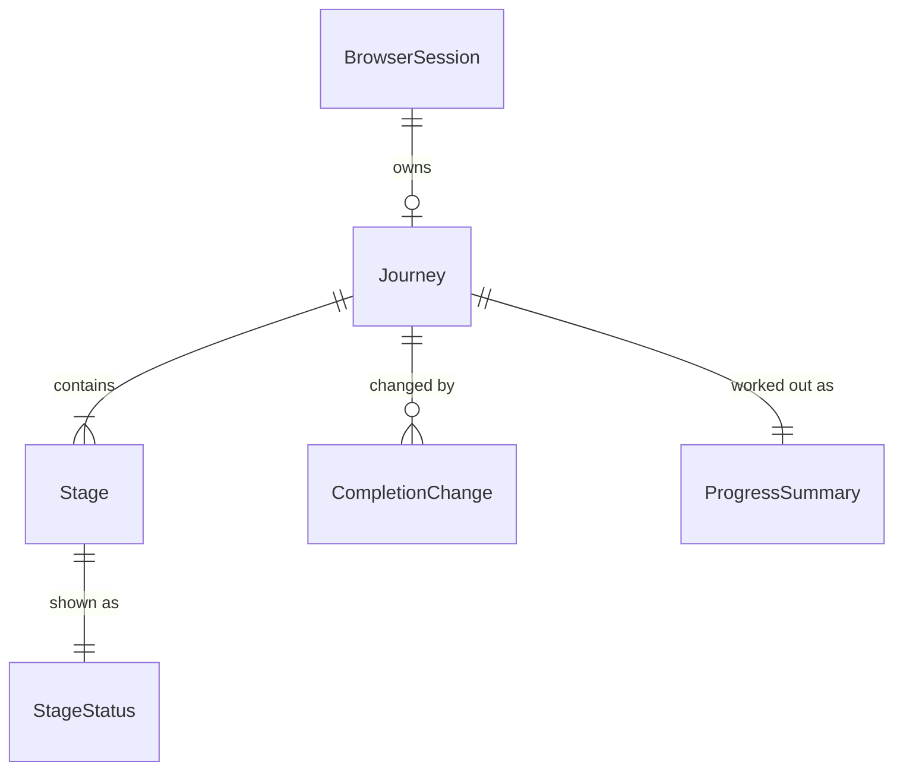

# Functional Specification — u2-progress

## Sources

- `unit-of-work.md` — `aidlc/spaces/default/intents/261110-learning-journey-app/inception/units-generation/unit-of-work.md`
- `unit-of-work-story-map.md` — `aidlc/spaces/default/intents/261110-learning-journey-app/inception/units-generation/unit-of-work-story-map.md`
- `stories.md` — `aidlc/spaces/default/intents/261110-learning-journey-app/inception/user-stories/stories.md`: US2.2, US3.1, US3.2, US3.3, US7.3
- `requirements.md` — `aidlc/spaces/default/intents/261110-learning-journey-app/inception/requirements-analysis/requirements.md`
- `components.md` — `aidlc/spaces/default/intents/261110-learning-journey-app/inception/domain-design/components.md`
- `contract-summary.md` — `aidlc/spaces/default/intents/261110-learning-journey-app/inception/contract-design/contract-summary.md`
- `interaction-spec.md` — `aidlc/spaces/default/intents/261110-learning-journey-app/inception/refined-mockups/interaction-spec.md`
- `entities.md` and `rules.md` in this folder
- The first unit's `functional-spec.md` — `aidlc/spaces/default/intents/261110-learning-journey-app/construction/u1-skeleton/functional-design/functional-spec.md` (its create flow and page-open flow stay in force)
- Functional design answers Q1 to Q4 — `functional-design-questions.md` in this folder

This is the source of truth for the order of steps and the states of a change. The data shapes are in `entities.md` and the decision rules in `rules.md`; the diagram and table at the end are derived from them.

## Workflow 1 — Mark a stage complete

Stories: US2.2 (the hours shown with it), US3.1. Rules: BR10.1, BR10.3, BR10.4, BR11.1 to BR11.5, BR13.1, BR13.2, BR13.5.

1. The learner opens a stage panel and presses "Mark stage N complete".
2. If any change is already being saved, the press is ignored (BR13.2). Otherwise the button goes busy with its label unchanged.
3. The page changes at once (BR13.1): the stage becomes done, the bar and percentage follow (BR10.1), the count reads "n of N complete", the panel of the stage now up next opens (BR10.4) and focus moves to its heading (to the "Journey complete" heading if this was the last stage). A polite announcement says what changed.
4. The page sends `PUT /api/v1/journey/stages/N/completion` with `{"completed": true}` and the session ID in the header.
5. The server checks the session ID, the stage number's form and the body (BR11.3). On failure it answers INVALID_REQUEST; go to step 13.
6. The store applies the change as one conditional update of the stored record (BR11.1, BR11.2): add N to the number set `completedStages`, only if the record exists, has not expired (expiresAt greater than now in whole epoch seconds) and N is no more than the stored stage count. In the same update it moves `lastActivityAt` to now and `expiresAt` to 90 days later (BR11.4). The whole call has 2 seconds in total (BR11.5).
7. If a condition fails, nothing is written and the database returns the record as it was: no record or an expired one answers NOT_FOUND (go to step 11); a stage number above the stage count answers INVALID_REQUEST (go to step 13).
8. If the store fails or is too slow the server answers SAVE_FAILED; go to step 10.
9. On success the server answers 200 with the full `completedStages` list in ascending order (an empty list when none), whether or not this call changed it. The page replaces its list with the answer (BR13.1) and the figures follow. The buttons leave their busy state. Done.
10. Save failed: if the failure was a network failure and no retry has been made, the page repeats the call once (BR13.5). Otherwise the page puts the stage back as it was, the figures follow, the pressed stage's panel reopens with focus on its button (BR10.4), and an inline "We couldn't save that change. Try again." shows beside the button with a "Try again" button. The page does not say it was saved. "Try again" repeats the same change from step 4. A write that timed out may still have been saved; repeating it is safe, and a reload shows the stored truth (BR11.5).
11. Journey gone: the page undoes the change, reopens the pressed stage's panel, and shows a plain message that this journey is no longer saved, with a button back to the home screen (BR13.3). No "Try again" is offered.
12. If the API answers a 429 with no error code at any point, the page puts the stage back and shows the "please wait" message (BR13.5, the first unit's throttle rule).
13. Invalid request: the page puts the stage back, reopens the pressed stage's panel and shows that the journey has changed with a "Reload" button that repeats the return-visit load (BR13.7). No "Try again" is offered.

Result states: marked and saved, save failed, journey gone, throttled, journey changed (invalid request).

## Workflow 2 — Mark a stage not complete

Stories: US3.2. Rules: BR10.1, BR10.3, BR10.4, BR11.1 to BR11.5, BR13.1, BR13.2, BR13.5.

1. The learner opens a done stage (any done stage can be opened to read again) and presses "Mark stage N as not complete".
2. Steps 2 to 13 of Workflow 1 apply with `{"completed": false}`, removing N from the set.
3. At step 3 the panel of the pressed stage stays open (BR10.4): focus stays on the button, now reading "Mark stage N complete", and no other panel opens. The announcement reads "Stage N marked as not complete. X of Y stages complete, Z percent."
4. If stage 1 was the only complete stage, the bar returns to 0% (AC3.2.1).

## Workflow 3 — Two tabs and repeats

Stories: US3.1 (AC3.1.3). Rules: BR11.1, BR11.3.

1. Tab A and tab B both show the journey. Both mark stage 2 complete, or one tab presses twice.
2. Each call adds 2 to the stored set. The second call finds 2 already there and leaves the set unchanged (BR11.1); it still answers 200 with the full list.
3. Each tab shows stage 2 complete once and counts it once, because each tab uses the list in the answer.
4. If tab B was loaded before tab A marked stage 2 and then marks stage 3, the stored set becomes 2 and 3; tab B's answer carries both, so tab B now shows stage 2 complete too. Nothing is undone. Tab A shows stage 3 only after its own next change or a reload (the other tab is not refreshed by itself).

## Workflow 4 — Come back later (return visit)

Stories: US3.3, US7.3. Rules: BR12.1, BR13.4, BR13.5, BR13.6. This replaces step 5 and the load part of the first unit's page-open flow; the rest of that flow stays.

1. The page opens. It finds the session ID or makes one as in the first unit. If storage is blocked it shows the clear message and stops (the first unit's blocked-storage rule).
2. The page shows a loading skeleton shaped like the journey and announces "Loading your journey" once, politely.
3. The page asks `GET /api/v1/journey`.
4. The store reads the record. If none exists, or the record's expiry has passed (90 days or more since the last change; exactly 90 counts as expired), it returns nothing and the server answers NOT_FOUND (BR12.1). A read changes nothing.
5. On success the skeleton is replaced by the journey with its saved completed stages applied: done stages marked, the bar, percentage, count and hours total worked out (BR10.1, BR10.2, BR10.3), and the up-next stage open (BR10.4). This happens within 3 seconds for 95% of loads.
6. On NOT_FOUND the home screen with the topic box shows, not an error (AC3.3.3).
7. If the load fails (LOAD_FAILED, or no answer in 10 seconds) the page repeats once if it was a network failure, then replaces the skeleton with an inline error with "Try again"; the other controls stay usable (BR13.5, AC3.3.2). "Try again" repeats from step 2.
8. If the API answers RATE_LIMITED the "please wait" message shows instead (the first unit's throttle rule).

## Workflow 5 — Show the progress and the hours

Stories: US2.2. Rules: BR10.1, BR10.2, BR10.3.

1. The sticky header shows the topic, a progress bar with its accessible name "Journey progress", the percentage as text, "n of N complete", and the hours total.
2. The total is the sum of the stage hours written as a whole number or to one decimal place (BR10.2). Stages of 2, 3, 3, 4 and 4 hours read "16 hours" (AC2.2.1).
3. Each stage line shows its own hours the same way and its status in words: "Done", "Up next" or "To do" (BR10.3).
4. A journey with 6 stages uses 6 in the count and the percentage; 1 of 6 reads 17% and 5 of 6 reads 83% (BR10.1).
5. A stage whose hours are missing never reaches this point: the first unit's reply check fails such output and the template is used instead (AC2.2.2).

## State machine — one stage's mark change

| From | Event | To |
|---|---|---|
| Not done | Learner presses "Mark stage N complete" | Saving (shown as done) |
| Done | Learner presses "Mark stage N as not complete" | Saving (shown as not done) |
| Saving | Press on any stage's button | Saving (ignored; one change at a time) |
| Saving | Server answers 200 with the list | Settled (the list is the truth) |
| Saving | Network failure, no retry yet | Saving (one retry) |
| Saving | Save failed after the retry, or SAVE_FAILED | Failed (put back as before; pressed panel reopens; inline error) |
| Saving | Server answers NOT_FOUND | Gone (put back; pressed panel reopens; "no longer saved" message) |
| Saving | Server answers INVALID_REQUEST | Changed (put back; pressed panel reopens; "journey has changed" with Reload) |
| Saving | Server answers 429 with no code | Failed with "please wait" (put back) |
| Failed | "Try again" | Saving |
| Gone | Button back to the home screen | Home screen |
| Changed | "Reload" | Return visit load (Workflow 4) |
| Settled | Next press on this stage | Saving |

## Business scenarios

| Scenario | Expected result |
|---|---|
| 5 stages, none complete, mark stage 1 | Bar 20%, "1 of 5 complete", stage 2 opens; all within 1 second |
| Stage 1 complete, unmark it | Bar 0%; stage 1 stays open and reads "Mark stage 1 complete" |
| 6 stages, mark 1 of them | 17%, "1 of 6 complete" |
| 6 stages, 5 complete | 83%, never 100% before the last |
| Mark the last stage | 100%, "Journey complete" heading takes focus, no panel open |
| Press the button twice quickly | One request; one change |
| Mark stage 2 in two tabs | Stage 2 complete once; progress counts it once |
| Tab B (older copy) marks stage 3 after tab A marked stage 2 | Stored set holds 2 and 3; tab B shows both after its answer |
| Save fails (SAVE_FAILED) | Stage put back; "We couldn't save that change. Try again."; never shown as saved |
| Network drops once during a mark | One automatic retry; success if the second try works |
| Journey deleted or expired, then a stage is marked | Stage put back; "this journey is no longer saved" with a button to the home screen |
| 429 with no error code on a mark | Stage put back; "please wait" message |
| Return visit with a saved journey | Skeleton, then the journey with progress, within 3 seconds |
| Return visit, load fails | Inline error with "Try again"; other controls usable |
| Return visit, no journey or expired journey | Home screen, not an error |
| Journey last changed 89 days ago | Returned; a mark extends its expiry |
| Journey last changed 91 days ago | Not returned, though the record may still exist |
| Exactly 90 days | Treated as expired |
| Stages of 2, 3, 3, 4, 4 hours | Total reads "16 hours" |
| Stage hours 2.5 and 3.25 | Written as 2.5 and 3.3; no long decimals |
| Stage number the journey does not have | INVALID_REQUEST (400); nothing changes |
| Journey replaced by a 5-stage one in another tab, then stage 6 is marked | INVALID_REQUEST; stage put back; "the journey has changed" with Reload |
| Stage number written "02", "+2" or "2.0" | INVALID_REQUEST; nothing changes |
| Last marked stage unmarked | The attribute is removed; the list reads empty; bar 0% |
| Press a second stage's button while one change is saving | Ignored; one change at a time |
| Failed save, panel had moved to the next stage | The pressed stage's panel reopens with the error and focus on its button |
| Body without a true or false completed | INVALID_REQUEST (400); nothing changes |

## Derived views

Entity relationships (derived from `entities.md`):

Rules summary (derived from `rules.md`): BR10 progress maths; BR11 the completion change in the store and API; BR12 expiry and privacy; BR13 the page.

## Assumptions & Open Questions

- [assumption] The status codes follow contract C1: 200 with the list, 400 INVALID_REQUEST, 404 NOT_FOUND, 500 SAVE_FAILED.
- [assumption] After an unmark, the panel the learner pressed in stays open and no other opens. The interaction spec words this as "the stage that was open before stays open" and also as "the first stage not yet complete opens"; the button lives in the open panel, so those can only both hold when the pressed stage stays open. This design reads it that way; tell me at the gate if the first-stage-not-complete reading was meant instead.
- [assumption] The first unit has not been deployed, so no journey saved with an empty `completedStages` list exists; U2's code generation changes the first unit's save to omit the field and to store the stage count. No conversion is built.
- [assumption] The home-screen button in the "no longer saved" message simply shows the first unit's home screen; the stale session ID is kept, since the same browser may make a new journey under it.
- None otherwise.
