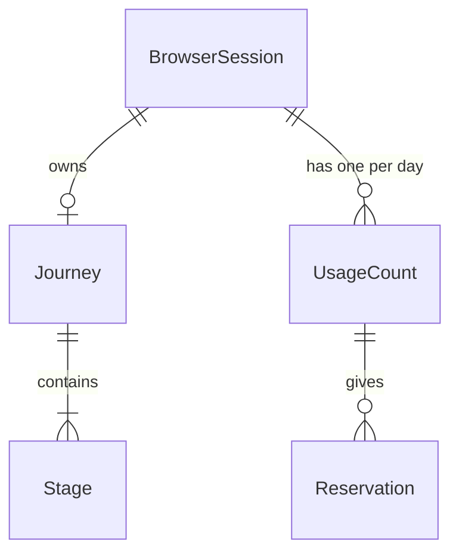

# Functional Specification — u3-protection

## Sources

- `unit-of-work.md` — `aidlc/spaces/default/intents/261110-learning-journey-app/inception/units-generation/unit-of-work.md`
- `unit-of-work-story-map.md` — `aidlc/spaces/default/intents/261110-learning-journey-app/inception/units-generation/unit-of-work-story-map.md`
- `stories.md` — `aidlc/spaces/default/intents/261110-learning-journey-app/inception/user-stories/stories.md`: US7.1, US7.2, US9.2 (the daily-cap part)
- `requirements.md` — `aidlc/spaces/default/intents/261110-learning-journey-app/inception/requirements-analysis/requirements.md`
- `components.md` — `aidlc/spaces/default/intents/261110-learning-journey-app/inception/domain-design/components.md`
- `contract-summary.md` — `aidlc/spaces/default/intents/261110-learning-journey-app/inception/contract-design/contract-summary.md`
- `interaction-spec.md` — `aidlc/spaces/default/intents/261110-learning-journey-app/inception/refined-mockups/interaction-spec.md`
- `entities.md` and `rules.md` in this folder
- The first unit's `functional-spec.md` — `aidlc/spaces/default/intents/261110-learning-journey-app/construction/u1-skeleton/functional-design/functional-spec.md` (its create flow, which this unit changes at the slot steps) and the second unit's — `aidlc/spaces/default/intents/261110-learning-journey-app/construction/u2-progress/functional-design/functional-spec.md`
- Functional design answers Q1 to Q4 — `functional-design-questions.md` in this folder

This is the source of truth for the order of steps and the states of a request. The data shapes are in `entities.md` and the decision rules in `rules.md`; the diagram and table at the end are derived from them.

## Workflow 1 — Create a journey with the daily cap

Stories: US9.2 (the daily-cap part). Rules: BR20.1 to BR20.4, BR21.1, BR21.2. This replaces the slot steps of the first unit's create flow (the always-grant stand-in); every other step of that flow stays.

1. The server checks the session ID and the topic as before, then starts the 15-second clock and the 18-second request cap.
2. It asks the usage guard for a slot for this session and today's UTC date (BR20.1, BR20.4).
3. The guard raises the day's count by one only if it is below 5, in one conditional update. A first request of the day creates the count at 1. It answers granted with the slots left and a reservation id.
4. If the guard's store fails or takes longer than 2 seconds, the guard answers granted with no reservation id, and a log line records that it was skipped (BR20.3). The request goes on.
5. If the count was already 5, the guard answers not granted. The request ends as DAILY_LIMIT (429): no model call, no template, nothing saved or deleted, and the existing journey untouched (BR21.1). Go to step 9.
6. The request carries on exactly as in the first unit: the model call, the checks, the retry or the template, and the save.
7. If a journey is saved the slot stays used. If the topic is refused, the save fails or is too slow, or an unexpected error ends the request with no journey, the generator releases the slot once and the count goes down by one (BR20.2). A failed release is logged and changes nothing the learner sees.
8. The server answers 201 with the journey, or the failure that applies, as in the first unit.
9. The browser shows the limit message (BR21.2): plain, not blaming, today's limit of 5 reached, come back tomorrow, and the current journey is still available when there is one. The typed topic is kept and the button enabled. A RATE_LIMITED or code-less 429 still shows the "please wait" message.

Result states: journey shown (AI), journey shown (template), topic invalid, topic not allowed, daily limit, throttled, save failed, no answer.

## Workflow 2 — Start a new journey (replace)

Stories: US7.1. Rules: BR22.1, BR22.2, BR24.1, BR24.2, BR20.2.

1. A saved journey is shown with a "Start a new journey" control.
2. The learner chooses it. A confirmation dialog opens naming the topic of the journey that would be replaced (BR22.1, BR24.1). Cancel has the initial focus.
3. If the learner cancels (button or Escape), the dialog closes, nothing changes, the saved journey stays shown, and focus returns to the control (AC7.1.2).
4. If the learner confirms, the topic screen appears. The saved journey is untouched and still stored. The screen offers a way back to the saved journey.
5. The learner types a topic and presses "Generate my journey". The create flow of Workflow 1 runs.
6. On success the new journey has been saved by the create request, which replaces the old record; the page shows the new journey (AC7.1.1).
7. On any other end (topic not allowed, daily limit, throttle, failed or timed-out create, save failure) the stored journey is unchanged, the typed topic is kept, and the way back to the saved journey is still offered (BR22.2). When the learner uses it, the saved journey is shown with its progress.
8. If the slot is refused at the cap, nothing is lost: the saved journey stays and the limit message shows (BR21.1).

Result states: replaced, cancelled, kept after a failed attempt.

## Workflow 3 — Delete my journey

Stories: US7.2. Rules: BR23.1, BR23.2, BR24.1, BR20.5.

1. A saved journey is shown with a "Delete my journey" control.
2. The learner chooses it. A confirmation dialog opens and names the topic that will be deleted and that its progress goes with it (AC7.2.1, BR24.1).
3. If the learner cancels, nothing changes and focus returns to the control.
4. If the learner confirms, the confirm button shows "Working…" and a second press is ignored. The page calls `DELETE /api/v1/journey` with the session ID in the header.
5. The server checks the session ID and removes the whole record in one step (BR23.1). The usage count is not touched (BR20.5). It answers 204, also when nothing was there.
6. On success the dialog closes, the home screen shows with focus on the topic box, and loading that session returns no journey.
7. If the call fails on the network and no retry has been made, the page repeats it once, as it is safe to repeat.
8. If the call fails (DELETE_FAILED, or no answer in 10 seconds) a plain message shows inside the dialog, the journey is kept, and the dialog stays open with Cancel and the confirm button so the learner can try again (AC7.2.2).
9. If the API answers a 429 with no error code, the dialog shows the "please wait" message and stays open.

Result states: deleted, cancelled, delete failed.

## State machine — a create request (changes to the first unit's table)

| From | Event | To |
|---|---|---|
| Idle | Valid topic submitted | Generating |
| Generating | Slot refused (count already 5) | Daily limit |
| Generating | Guard store failed | Generating (guard skipped, logged) |
| Generating | Reply is a refusal | Not allowed (slot released) |
| Generating | Save failed, too slow, or unexpected error | Failed (slot released) |
| Generating | Journey saved | Shown (slot kept) |
| Daily limit | Learner edits the topic or presses the button again | Idle (the limit still holds until the next UTC day) |

All other rows of the first unit's table stay as they are.

## State machine — the confirmation dialogs

| From | Event | To |
|---|---|---|
| Closed | Learner chooses "Start a new journey" or "Delete my journey" | Open |
| Open | Cancel, Escape | Closed (nothing changed; focus back on the opener) |
| Open | Confirm (replace) | Closed, topic screen shown (saved journey kept) |
| Open | Confirm (delete) | Busy |
| Busy | Delete answers 204 | Closed, home screen shown |
| Busy | Delete fails | Open with a message (journey kept) |
| Busy | Confirm pressed again | Busy (ignored) |

## Business scenarios

| Scenario | Expected result |
|---|---|
| First journey of the day | Count goes to 1; the journey is shown |
| Fifth journey of the day | Count reaches 5; the journey is shown |
| Sixth journey of the day | DAILY_LIMIT; the limit message; no model call; existing journey unchanged |
| Two requests at the same moment with 4 used | One gets the fifth slot; the other is told the limit is reached; the count stays 5 |
| Topic refused by the model | Slot released; count unchanged by the attempt |
| Save fails after the model answered | Slot released once; SAVE_FAILED shown with "Try again" |
| Template journey made because Bedrock is down | Slot kept (a journey was made) |
| Guard's store unreachable | Request goes ahead; a log line says the guard was skipped |
| Delete a journey, then make a new one the same day | The day's count is not reset; the new journey uses the next slot |
| Midnight UTC passes | A new count starts at 0 for the new date |
| Start a new journey, cancel the dialog | Nothing changes; saved journey stays shown |
| Start a new journey, confirm, then the topic is refused | Saved journey still stored; way back offered |
| Start a new journey, confirm, then reach the daily limit | Saved journey still stored; limit message shown |
| Start a new journey, confirm, then a new journey is saved | The page shows the new journey; the old one is gone |
| Delete my journey, confirm | Home screen; loading returns no journey |
| Delete my journey, the call fails | Message in the dialog; journey kept; dialog stays open |
| Delete pressed twice or repeated | Second press ignored; a repeated delete is a success |
| 11 requests in the same instant | The 11th gets RATE_LIMITED and the "please wait" message (not the limit message) |
| Browser sends a different date | Ignored; the server's UTC date is used |

## Derived views

Entity relationships (derived from `entities.md`):

Rules summary (derived from `rules.md`): BR20 the usage guard; BR21 at the cap; BR22 starting a new journey; BR23 deleting; BR24 the dialogs and controls.

## Assumptions & Open Questions

- [assumption] The status codes follow contract C1: 201, 400, 422, 429 (DAILY_LIMIT or RATE_LIMITED), 500 for a create; 204 or 400 or 500 (DELETE_FAILED) for a delete.
- [assumption] The way back from the topic screen to the saved journey is a plain button on that screen; its exact wording is settled in code generation using the refined mockups.
- None otherwise.
