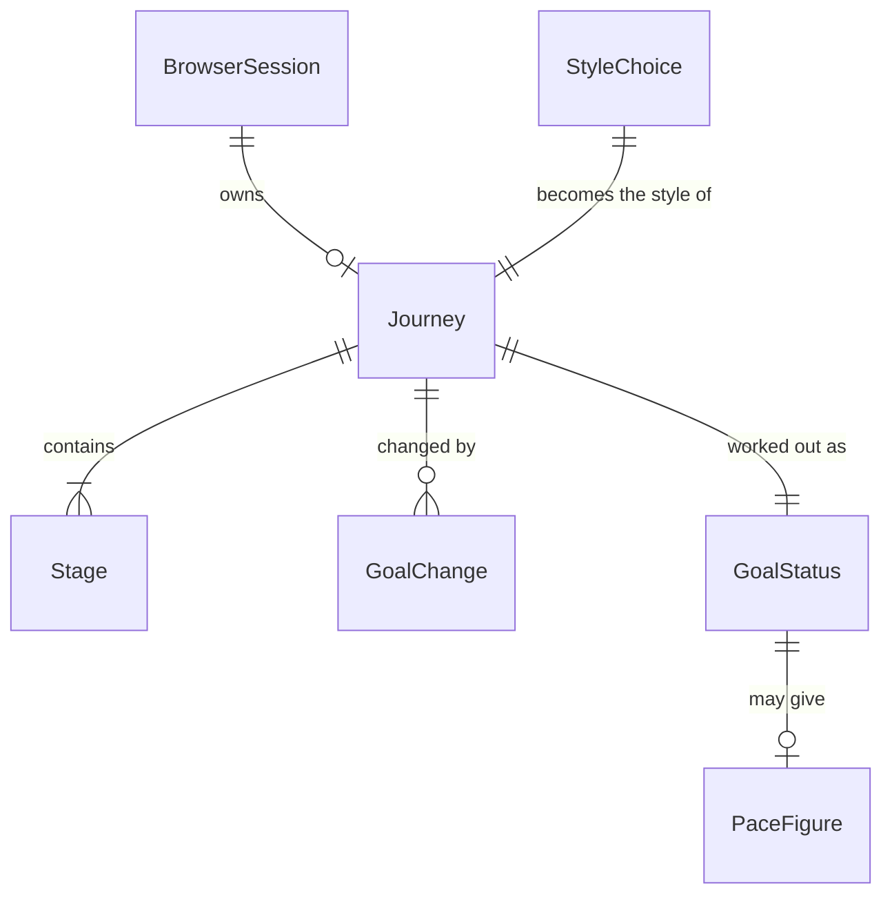

# Functional Specification — u4-goals-and-style

## Sources

- `unit-of-work.md` — `aidlc/spaces/default/intents/261110-learning-journey-app/inception/units-generation/unit-of-work.md`
- `unit-of-work-story-map.md` — `aidlc/spaces/default/intents/261110-learning-journey-app/inception/units-generation/unit-of-work-story-map.md`
- `stories.md` — `aidlc/spaces/default/intents/261110-learning-journey-app/inception/user-stories/stories.md`: US1.2, US4.1, US4.2
- `requirements.md` — `aidlc/spaces/default/intents/261110-learning-journey-app/inception/requirements-analysis/requirements.md`
- `components.md` — `aidlc/spaces/default/intents/261110-learning-journey-app/inception/domain-design/components.md`
- `contract-summary.md` — `aidlc/spaces/default/intents/261110-learning-journey-app/inception/contract-design/contract-summary.md`
- `interaction-spec.md` — `aidlc/spaces/default/intents/261110-learning-journey-app/inception/refined-mockups/interaction-spec.md`
- `entities.md` and `rules.md` in this folder
- The earlier units' `functional-spec.md` — `aidlc/spaces/default/intents/261110-learning-journey-app/construction/u1-skeleton/functional-design/functional-spec.md` (the create flow, which this unit changes at the style steps), `.../u2-progress/functional-design/functional-spec.md` (the header, the one-change-at-a-time page) and `.../u3-protection/functional-design/functional-spec.md` (replace and delete)
- Functional design answers Q1 to Q4 — `functional-design-questions.md` in this folder

This is the source of truth for the order of steps and the states of a change. The data shapes are in `entities.md` and the decision rules in `rules.md`; the diagram and table at the end are derived from them.

## Workflow 1 — Choose a style and create a journey

Stories: US1.2. Rules: BR33.1 to BR33.6, BR34.1. This changes the style steps of the earlier create flow; every other step of it stays.

1. The topic screen opens (on a first visit, or through "Start a new journey"). Three style choices (friendly guide, structured instructor, planner) are shown with nothing selected (BR33.1). The "Generate my journey" button is disabled and a visible hint says a style must be chosen.
2. The learner types a topic and picks a style with the keyboard or the pointer. When the topic passes the earlier topic checks and a style is chosen, the button is enabled. If a topic is typed and no style is chosen the button stays disabled and says why (AC1.2.1).
3. The learner presses the button. The browser sends the create call with the topic and the style, and the session ID in the header.
4. The server checks the session ID, the topic and the style (BR33.2). A style that is not one of the three answers INVALID_REQUEST with no model call; an absent style is read as the guide style.
5. The generator reserves a slot and builds the request with the chosen style's tone and emphasis (BR33.3), then calls the model, as before.
6. It checks the reply with the earlier checks and the style's own (BR33.4): for the instructor style every stage must have at least 2 exercises and at least 1 quiz item; for the planner style every stage must have the four hours and they must add up to the stage hours within 0.1.
7. An invalid reply is retried once if at least 5 seconds of the 15 remain, otherwise the template is used, exactly as before. The template is the same for every style and carries no breakdown (BR33.5).
8. The journey is saved with its style and with no goal date (BR34.1), replacing any earlier one, and the server answers 201.
9. The page shows the journey: the style's name in the header (BR33.6), and for an AI planner journey each open stage shows the four hours beside its total.

Result states: as in the earlier create flow, plus invalid request for a bad style.

## Workflow 2 — Set, change or clear the goal date

Stories: US4.1. Rules: BR30.1, BR30.2, BR30.3, BR30.4, BR31.1 to BR31.3, BR32.1.

1. The header shows "Set a goal date" (no goal) or the date with "Change" (a goal). The learner chooses it. The goal form opens with the label "Goal date", a date field limited from today to 365 days ahead, Save and Clear; the earlier focus rules apply (BR31.1).
2. The learner enters or picks a date and presses Save. The page checks it (BR30.1): a real calendar date in the form YYYY-MM-DD from today to today plus 365 days. If it is not allowed, the message is shown beside the field, what was typed is kept, and nothing is sent. If the entry is not a date, the message names the format expected.
3. If it is allowed, the header changes at once: the date, the days remaining (BR30.2) and the pace (BR30.3). The form closes and focus returns to the opener. While a goal change is saving, Save and Clear ignore presses, and so do "Start a new journey" and "Delete my journey" (BR31.1, BR31.2). The polite announcement "Goal date saved" is made only when the server's answer arrives (step 8).
4. The page sends `PUT /api/v1/journey/goal` with `{"goalDate": "YYYY-MM-DD"}` and the session ID in the header. For Clear it sends `{"goalDate": null}`; after the answer the header shows "Set a goal date" with no pace and "Goal date cleared" is announced.
5. The server checks the session ID and the body (BR32.1): goalDate is null or a real calendar date in the form YYYY-MM-DD. On failure it answers INVALID_REQUEST; go to step 9.
6. The store applies the change as one conditional update of the goal date only: set the date, or remove the attribute for null, only if the record exists and has not expired; in the same update it moves the last-activity time and the expiry (BR32.1). One attempt, 2 seconds in total.
7. If there is no live journey the server answers NOT_FOUND; go to step 10.
8. On success the server answers 200 with the stored goal date (or null). The page uses it as the truth. Setting the same value again, or clearing an absent date, is a success. Done. If the store fails or is too slow the server answers SAVE_FAILED: if the failure was a network failure and no retry has been made the page repeats once; otherwise the page puts the old value back, the header follows, and an inline error with "Try again" shows beside the goal line (BR31.2). "Try again" repeats the same change from step 4.
9. Invalid request: the page puts the old value back and shows that the date could not be used, reopening the form (BR31.3). No "Try again" is offered for the same date.
10. Journey gone: the page puts the old value back and shows the plain "this journey is no longer saved" message with a button to the home screen (BR31.3).
11. A 429 with no error code puts the old value back and shows the "please wait" message (BR31.2).

Result states: saved, cleared, date not allowed (no request), save failed, journey gone, invalid request, throttled.

## Workflow 3 — Keep the goal in view

Stories: US4.2. Rules: BR30.2, BR30.3, BR30.4.

1. A journey with a goal date shows, in the sticky header, the goal date and the days remaining while the learner scrolls through the stages (AC4.2.1). Under 768 pixels the goal line sits in the header's "Details" disclosure.
2. The state follows the learner's local calendar date (BR30.2): more than 0 days shows "N days left"; 0 shows "Due today"; below 0 shows "Goal date passed — choose a new date", in an encouraging tone, with the button to choose a new date. The state is recalculated when the journey is shown and when the date changes at midnight local time while the page stays open.
3. While the goal is upcoming and at least one stage is not done, the header also shows "about N hours per week" (BR30.3): the hours of the stages not yet done divided by the whole weeks left (days remaining over 7, rounded up, at least 1), written as a whole number or to one decimal place. With 16 hours, nothing done and a goal 28 days away it reads 4 hours per week (AC4.2.3).
4. Marking or unmarking a stage changes the pace at once. With every stage done, on the goal date, after it, or with no goal date, no pace is shown.
5. With no goal date the header shows "Set a goal date" and no pace.

## State machine — a goal change

| From | Event | To |
|---|---|---|
| Closed | Learner chooses "Set a goal date" or "Change" | Open |
| Open | Escape, or the form is closed | Closed (nothing changed) |
| Open | Save with a date that is not allowed | Open with a message (nothing sent) |
| Open | Save with an allowed date, or Clear | Saving (header changed at once) |
| Saving | Press on Save or Clear | Saving (ignored; one goal change at a time) |
| Saving | Server answers 200 | Settled (the answer is the truth) |
| Saving | Network failure, no retry yet | Saving (one retry) |
| Saving | Save failed after the retry | Failed (old value back; inline error) |
| Saving | Server answers NOT_FOUND | Gone (old value back; "no longer saved" message) |
| Saving | Server answers INVALID_REQUEST | Rejected (old value back; message; form kept open) |
| Saving | Server answers 429 with no code | Failed with "please wait" (old value back) |
| Failed | "Try again" | Saving |
| Gone | Button back to the home screen | Home screen |

## Business scenarios

| Scenario | Expected result |
|---|---|
| Topic typed, no style chosen | The button is disabled and a hint says a style must be chosen |
| Style chosen, valid topic | The button is enabled |
| Start a new journey after an instructor journey | The style radios start empty again |
| Create call with no style (an older page) | Made in the guide style |
| Create call with the style "expert" | INVALID_REQUEST; no model call |
| Instructor style, model gives a stage with 1 exercise | Reply invalid; one retry if time allows, otherwise the template |
| Planner style, model gives hours that add up to 3 for a stage of 5 | Reply invalid; retry or template |
| Planner style, template used | Every stage shows its total only, no breakdown |
| Guide, instructor and planner template | The same journey whichever style was chosen |
| Goal date yesterday | Not allowed; message beside the field; nothing sent |
| Goal date today | Allowed; the header reads "Due today" |
| Goal date today plus 365 days | Allowed |
| Goal date today plus 366 days | Not allowed |
| Entry "next friday" | Message names the format YYYY-MM-DD |
| Goal date set, then scroll through the stages | The goal date and days remaining stay visible |
| Goal date 4 weeks away, 16 hours, nothing done | "About 4 hours per week" |
| Same goal, two stages of 4 hours done | Pace falls to 2 hours per week |
| Goal 2 days away, 16 hours left | "About 16 hours per week" (one week, not a huge figure) |
| Every stage done | No pace |
| Goal date yesterday (stored) | "Goal date passed — choose a new date" |
| Midnight passes with the page open | The state and days remaining update |
| Set a goal date, the save fails | Old value back; "Try again" |
| Set a goal date, the journey was deleted in another tab | Old value back; "no longer saved" with a home button |
| Clear a goal date that is not set | Success; nothing changes |
| Set the same date twice | Success; same result |
| Start a new journey while a goal date is set | The new journey has no goal date |
| Goal date `2026-02-30` sent by a script | INVALID_REQUEST |

## Derived views

Entity relationships (derived from `entities.md`):

Rules summary (derived from `rules.md`): BR30 the goal rules; BR31 the goal form and its save; BR32 the goal call; BR33 the style; BR34 a replacement starts with no goal date.

## Assumptions & Open Questions

- [assumption] The status codes follow contract C1: 200 with the stored goal date, 400 INVALID_REQUEST, 404 NOT_FOUND, 500 SAVE_FAILED for the goal call; 201, 400 (including a bad style), 422, 429, 500 for the create call.
- [assumption] A style radio set that is a group of native radio buttons, with one label each, is acceptable for the interaction spec's style choice; its exact look is settled in code generation.
- None otherwise.
