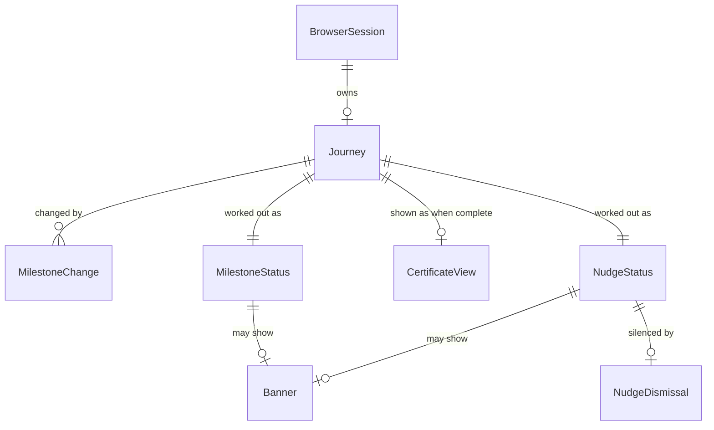

# Functional Specification — u5-encouragement

## Sources

- `unit-of-work.md` — `aidlc/spaces/default/intents/261110-learning-journey-app/inception/units-generation/unit-of-work.md`
- `unit-of-work-story-map.md` — `aidlc/spaces/default/intents/261110-learning-journey-app/inception/units-generation/unit-of-work-story-map.md`
- `stories.md` — `aidlc/spaces/default/intents/261110-learning-journey-app/inception/user-stories/stories.md`: US5.1, US5.2, US6.1
- `requirements.md` — `aidlc/spaces/default/intents/261110-learning-journey-app/inception/requirements-analysis/requirements.md`
- `components.md` — `aidlc/spaces/default/intents/261110-learning-journey-app/inception/domain-design/components.md`
- `contract-summary.md` — `aidlc/spaces/default/intents/261110-learning-journey-app/inception/contract-design/contract-summary.md`
- `interaction-spec.md` — `aidlc/spaces/default/intents/261110-learning-journey-app/inception/refined-mockups/interaction-spec.md`
- `entities.md` and `rules.md` in this folder
- The earlier units' `functional-spec.md` — `aidlc/spaces/default/intents/261110-learning-journey-app/construction/u2-progress/functional-design/functional-spec.md` (the stage change, the header and the one-change-at-a-time page) and `.../u4-goals-and-style/functional-design/functional-spec.md` (the goal state and days remaining)
- Functional design answers Q1 to Q4 — `functional-design-questions.md` in this folder

This is the source of truth for the order of steps and the states of a change. The data shapes are in `entities.md` and the decision rules in `rules.md`; the diagram and table at the end are derived from them.

## Workflow 1 — A milestone after a stage is marked

Stories: US5.1. Rules: BR40.1 to BR40.3, BR43.1, BR43.2, BR44.1, BR44.2. This adds steps to the end of the second unit's mark workflow; every earlier step of it stays.

1. A stage MARK is confirmed by the server with the full list of completed stages (second unit). The milestone steps below run only after a confirmed mark: never after an unmark and never on a plain page load.
2. The page works out the milestone status (BR40.1) against its shown set, which was filled from the loaded journey and holds every milestone shown or recorded so far in this visit: which of first-stage, halfway and complete are reached, and which of those are new (not in the set and not lower than a milestone in the set).
3. If none is new, nothing more happens.
4. If one or more is new, the page picks the highest (complete, then halfway, then first-stage) to show and marks the lower new ones to be recorded without being shown (BR40.2).
5. The banner for the one to show appears above the journey in a polite status region: a short warm message, a hidden icon, and a Dismiss button reachable by keyboard (BR43.2). It does not take focus. The milestone is added to the page's shown set at once (BR40.1). If a nudge banner is already shown, the milestone takes its place and the nudge returns afterwards if it still applies and is not dismissed (the state machine below); a replaced milestone banner is simply gone, because it has already been recorded.
6. The page records the milestones, one call each from lowest to highest: `PUT /api/v1/journey/milestones` with `{"milestone": "..."}` and the session ID in the header (BR40.3).
7. The server checks the session ID and the milestone name (BR44.1), adds the name to the stored set in one conditional update that needs a live journey, moves the last-activity time and the expiry, and answers 200 with the set in the fixed order.
8. On a network failure the page repeats the call once, quietly. On NOT_FOUND, INVALID_REQUEST, SAVE_FAILED or a 429 it says nothing and leaves the banner as it is (BR44.2); an unrecorded milestone may show again after a later confirmed mark while its condition still holds.
9. The learner dismisses the banner, or leaves it; once recorded it never shows again, also after unmarking and marking the stage again (BR40.2).

Result states: milestone shown and recorded, milestone shown but not recorded, nothing new.

## Workflow 2 — The completion view and the certificate

Stories: US5.2. Rules: BR41.1 to BR41.3, BR40.1, BR43.2.

1. The page loads a journey with every stage done, or the server confirms the mark of the last stage. Every stage is done. The view becomes the completion view (BR41.1).
2. The page shows the completion view: the heading "Journey complete" receives focus, and a labelled certificate panel shows the topic as plain text, today's date in the learner's local calendar in a plain long form, and "5 stages" or "6 stages". The header, the goal line and the "Start a new journey" and "Delete my journey" controls stay, and a "Back to my journey" button is added. If the learner has just marked the last stage and the complete milestone is new, its banner appears above the certificate (Workflow 1) without taking focus; a plain load of a finished journey shows no banner.
3. The learner may type a name into the field labelled "Name on certificate (optional, not saved)". It appears on the certificate at once. It is held in page memory only; it is never sent, stored in the browser, logged, or put in an announcement (BR41.2).
4. The learner chooses "Print or save certificate"; the browser's print dialog opens and the print style shows only the certificate panel in black and white (BR41.3).
5. If the learner wants to unmark a stage they choose "Back to my journey" (BR41.1): the journey view shows with every stage still done, the topic as its heading (the "Journey complete" heading belongs only to the completion view), no panel open, and focus on that heading. A done stage is opened and unmarked as in the second unit; the unmark returns the journey at the lower value (80% for 5 stages) with focus handled as the second unit says (AC5.2.3), and no banner is shown for it. Marking the stage again shows the completion view again; the complete milestone does not show again.
6. A reload of a finished journey shows the completion view again with no name (it was in memory only).
7. At local midnight the date on the certificate updates if the page is still open.

Result states: completion view with a name, completion view without a name, printing, back to the journey view.

## Workflow 3 — The nudge

Stories: US6.1. Rules: BR42.1 to BR42.4, BR43.1, BR43.2, BR45.1.

1. The page evaluates the nudge when the journey is shown, after a confirmed stage change, after a goal change, at local midnight, and when the tab becomes visible again (BR42.1).
2. The nudge applies only when progress is below 50%, a goal date is set, and the days remaining in the learner's local calendar are 0, 1, 2 or 3. With 1 of 5 stages done and a goal date 3 days away it applies; with 3 of 5, 4 days away, no goal date, a passed goal date or a complete journey it does not.
3. If it applies and no milestone banner is showing, the page looks for a dismissal marker in the browser's storage under today's key (goal date and local date) (BR42.3). If one exists the nudge is not shown.
4. Otherwise the banner shows one of the fixed messages for 0, 1, 2 or 3 days left (BR42.2): encouraging, with a small next step, naming the next stage by its number and how many stages are left, and with no text from the AI.
5. The learner dismisses it with the keyboard-reachable button; a marker is stored under today's key; the nudge goes at once and does not return on reload today (BR42.3). With storage blocked, the dismissal lasts only until the page is reloaded.
6. If a milestone banner is showing when the nudge applies, the nudge waits and appears after that banner is dismissed, if it still applies (BR43.2).
7. No request is made for any of this (BR42.4).

Result states: nudge shown, nudge dismissed for today, no nudge.

## State machine — the banner area

| From | Event | To |
|---|---|---|
| Empty | A milestone is newly reached after a confirmed mark | Milestone banner (recorded in the background) |
| Empty | The nudge applies and is not dismissed for today | Nudge banner |
| Nudge banner | A milestone is newly reached | Milestone banner (the nudge returns afterwards if it still applies and is not dismissed) |
| Milestone banner | The nudge applies | Milestone banner (the nudge waits) |
| Milestone banner | Dismiss | Empty, then the waiting nudge if it applies |
| Nudge banner | Dismiss | Empty (a dismissal marker is stored for today) |
| Nudge banner | The conditions stop holding (progress reaches 50%, the goal changes or passes, the day changes) | Empty |
| Any banner | Page reload | Empty (a recorded milestone is not shown again; a dismissed nudge is not shown again today) |

## Business scenarios

| Scenario | Expected result |
|---|---|
| 5 stages, mark the first | A "first stage" banner; recorded |
| 5 stages, mark the third done (two done before) | A "halfway" banner (3 of 5 is at least half) |
| 5 stages, mark the fifth | The completion view and the "complete" banner |
| 6 stages, 3 done | The halfway banner (3 of 6 is at least half) |
| Mark stage 4 first of 5 | 1 of 5 is done, so only first-stage is reached and its banner shows (stage order does not matter) |
| Stages 1 and 2 done, then stage 5 marked (3 of 5) | Halfway is newly reached and first-stage was already shown: the halfway banner shows |
| First-stage never shown (an earlier recording failed), then 3 of 5 are done in one confirmed mark | Only the halfway banner shows; first-stage is recorded as shown without being shown |
| Last stage marked with first-stage and halfway never shown | Only the "complete" banner shows; the other two are recorded as shown |
| Dismiss the halfway banner, mark another stage | It does not return |
| Dismiss the halfway banner, its recording failed, mark another stage in the same visit | It does not return: the page's shown set already holds it |
| Halfway recorded earlier but first-stage never recorded; unmark down, then mark one stage | No "first stage" banner: a milestone lower than a shown one counts as shown |
| Complete recorded earlier but halfway never recorded | No halfway banner either |
| Two quick marks while the first recording is still running | Each banner is shown once, never twice |
| Replace the journey with a new one in the same visit, then mark its first stage | The new journey gets its own first-stage banner |
| Journey finished in another tab, then this tab is loaded | The completion view, no banner |
| Choose "Back to my journey" on the completion view | The journey view at 100% with the topic as its heading, no panel open |
| Unmark stage 5 after that | The journey at 80%; no banner |
| Unmark stage 5, mark it again | The completion view returns; the "complete" banner does not |
| Reload a finished journey | The completion view with no name |
| Type a name, reload | The name is gone |
| Name containing `<script>` | Shown as plain text; nothing runs |
| 1 of 5 done, goal date 3 days away | A nudge shows |
| 3 of 5 done, goal date 3 days away | No nudge |
| 3 of 6 done (exactly 50%), goal date 2 days away | No nudge |
| 2 of 5 done, goal date 4 days away | No nudge |
| 1 of 5 done, goal date today | A nudge shows (0 days) |
| 1 of 5 done, goal date yesterday | No nudge ("Goal date passed" is shown by the header) |
| Nudge dismissed, page reloaded the same day | No nudge |
| Nudge dismissed, next day, conditions still hold | The nudge may show again |
| Goal date changed after a dismissal | A different key; the nudge may show |
| Browser blocks storage | The dismissal lasts until reload |
| Milestone recording fails once | One quiet repeat; the banner stays |
| Milestone recording finds the journey gone | Nothing is said; the next action shows "no longer saved" |
| Any milestone or nudge text | Contains no blocked word or phrase (checked by a test over every message) |

## Derived views

Entity relationships (derived from `entities.md`):

Rules summary (derived from `rules.md`): BR40 milestones; BR41 the completion view and certificate; BR42 the nudge; BR43 the blocked-word list and banners; BR44 the milestone call; BR45 the three pieces stay separable.

## Assumptions & Open Questions

- [assumption] The status codes follow contract C1: 200 with the milestones shown, 400 INVALID_REQUEST, 404 NOT_FOUND, 500 SAVE_FAILED for the milestone call.
- [assumption] The completion view's "Back to my journey" button has the exact wording settled in code generation; its behaviour is rule BR41.1.
- None otherwise.
