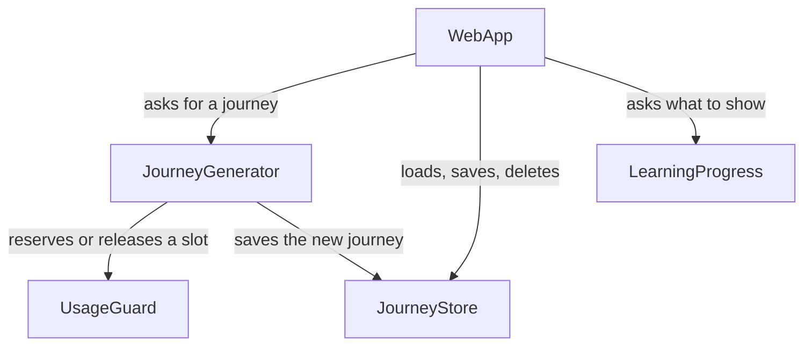

# Component Catalogue — Learning Journey App

## Sources

- `requirements.md` — `aidlc/spaces/default/intents/261110-learning-journey-app/inception/requirements-analysis/requirements.md`
- `stories.md` — `aidlc/spaces/default/intents/261110-learning-journey-app/inception/user-stories/stories.md`
- `team-practices.md` — `aidlc/spaces/default/intents/261110-learning-journey-app/inception/practices-discovery/team-practices.md`
- Design answers Q1 to Q6 — `domain-design-questions.md` in this folder
- `decisions.md` in this folder (the decision records behind this catalogue)

This catalogue names the building blocks (code to be written) and who owns which data, at the level of ownership and shape only. Field types, limits and relationships belong to Functional Design. How the blocks are grouped and deployed belongs to Units Generation, so nothing here says which block runs on the server and which in the browser beyond what the answers fixed: the progress rules run in the browser and the rest of the logic is behind the backend. [Q2]

## Machine-Readable Catalogue

```yaml
components:
  - name: JourneyGenerator
    summary: Turns a topic and a teaching style into a 5 to 6 stage journey, with a template when the AI cannot deliver.
    behaviour: >
      Trims the topic and requires 2 to 100 characters. Reserves a slot with the usage guard before doing any
      work and stops with a clear reason if the session has no slot left today. Builds the AI request with the
      topic passed as delimited data that cannot change the instructions, and asks the model to refuse
      non-professional or unsafe topics by answering with a refusal marker instead of a journey. A refusal is a
      distinct outcome recognised before the structure check: it ends the request as "topic not allowed" with no
      retry, no template, no save and no count against the daily cap, so the reserved slot is released and the
      WebApp shows the "try a different topic" message. Otherwise checks the reply for 5 or 6 stages, every
      required field per stage, and hours as numbers. Works to
      one budget of 15 seconds counted across all attempts together; a retry starts only if at least 5 seconds
      remain. Falls back to a 5-stage template with the topic name inserted, identical for every teaching style,
      when the call fails, the reply is invalid with no time to retry, it is invalid twice, or 15 seconds pass;
      a template journey keeps the reserved slot. If an unexpected error ends the request with no journey, the
      slot is released. Marks the journey as AI or template. Uses the friendly guide style when no style is
      supplied. Never sends
      model output on as markup. Logs whether each journey came from the AI or the template, without any typed
      name. The AI call sits behind a small interface with a real and a fake version.
    responsibilities:
      - Topic checking and AI request building
      - Recognising an AI refusal and ending the request with "topic not allowed"
      - AI reply checking, retry within the time budget, and template fallback
      - Marking the journey source (AI or template)
      - Reserving and releasing a slot with the usage guard and asking the journey store to save the result
    depends_on:
      - component: UsageGuard
        interaction: Reserve a slot before building a journey, and release it if the request ends in a refusal or an unexpected error
        style: sync
      - component: JourneyStore
        interaction: Save the new journey, replacing any earlier one for the session
        style: sync
    dependents:
      - component: WebApp
        interaction: Requests a journey for a topic and style
    external_dependencies:
      - name: Amazon Bedrock with Amazon Nova Lite
        kind: third-party-api
        purpose: Writes the journey content
    entities: []

  - name: JourneyStore
    summary: Saves, loads, expires, replaces and deletes the one journey each session holds.
    behaviour: >
      Holds at most one Journey per anonymous session. Saving a new journey replaces the old one. Marking a stage
      complete adds it to the set of completed stages and unmarking removes it, so repeating either has the same
      result as doing it once, also from two tabs. Updates to the completed stages, the goal date and the
      milestones shown are partial, set-based changes to that one field, never a rewrite of the whole record, so
      a change made from an older copy in another tab cannot undo a newer one. Records the goal date, which
      milestones were shown, and the time of last activity. Every save extends the expiry to 90 days after the
      last activity. A read treats a journey as gone once 90 days have passed, even if the database has not yet
      removed it. Deleting removes the journey with its progress, goal date and milestone memory in one step.
      Stores no name, email or other personal information.
    responsibilities:
      - Persisting the Journey and its stages, completed stages, goal date and milestones shown
      - Expiry, deletion and replacement
      - Idempotent marking and unmarking of stages
    depends_on: []
    dependents:
      - component: WebApp
        interaction: Loads the journey, saves progress and goal changes, and deletes it
      - component: JourneyGenerator
        interaction: Saves each newly built journey
    external_dependencies:
      - name: DynamoDB table with expiry
        kind: database
        purpose: Holds the Journey record per session
    entities:
      - name: Journey
        identifier: sessionId
        attributes: [sessionId, topic, teachingStyle, source, stages, completedStages, goalDate, milestonesShown, createdAt, lastActivityAt, expiresAt]
        references:
          - entity: BrowserSession
            owned_by: WebApp
            relationship: each Journey belongs to one anonymous browser session
      - name: Stage
        identifier: stageNumber within its Journey
        attributes: [stageNumber, title, whatItIs, whyItMatters, afterThis, materials, hours]

  - name: LearningProgress
    summary: The rules that turn a journey, its completed stages, the goal date and today's date into what the learner sees.
    behaviour: >
      Pure rules with no storage. Works out the percentage and the count of stages complete, the hours total,
      the suggested hours per week when a goal date is set, calendar days remaining in the learner's local date,
      the goal states (none, upcoming, due today, passed), which milestone is due and not yet shown (first stage
      done, at least half of the stages done, all done), whether the nudge applies (progress below 50 percent, a
      goal date set, and 0 to 3 days remaining), the certificate details (topic, today's date, number of
      stages), whether the goal date is allowed (today up to 365 days ahead), and which stage should be open
      after marking or unmarking. Written and tested first, as the team practices require.
    responsibilities:
      - Progress maths, hours and pace
      - Goal date rules and days remaining
      - Milestone and nudge rules
      - Certificate details and the open-stage rule
    depends_on: []
    dependents:
      - component: WebApp
        interaction: Calls these rules to decide what to show
    external_dependencies: []
    entities: []

  - name: UsageGuard
    summary: Keeps each session to 5 new journeys a day.
    behaviour: >
      Owns a small count per session per day. Reserves a slot with a conditional increment that refuses once the
      count is 5, so two requests at the same moment cannot take it past 5; the second is told the daily limit
      is reached. A reserved slot is released when the request ends with no journey (a refused topic or an
      unexpected error) and is kept when a journey, AI or template, is created. The count expires a day or two
      after its date. It carries no personal information. The cap is a courtesy limit: the
      session ID is created in the browser, so a script can change it, and the API-wide rate limit and the
      budget alert remain the real backstop.
    responsibilities:
      - Session-and-day journey count
      - Reserve, keep or release a slot, and refuse with the reason when none is left
    depends_on: []
    dependents:
      - component: JourneyGenerator
        interaction: Reserves a slot before building a journey and releases it when no journey results
    external_dependencies:
      - name: DynamoDB table with expiry
        kind: database
        purpose: Holds the count per session and day
    entities:
      - name: UsageCount
        identifier: sessionId and date
        attributes: [sessionId, date, journeysCreated, expiresAt]
        references:
          - entity: BrowserSession
            owned_by: WebApp
            relationship: each count belongs to one anonymous browser session

  - name: WebApp
    summary: The screens the learner uses, with the anonymous session and the calls to the backend.
    behaviour: >
      Shows the home screen, the journey with its sticky header, banners, confirmation dialogs and the
      certificate, with the states and wording in the refined mockups. Creates a random anonymous session ID on
      first visit and keeps it in the browser. Calls the generator and the store, and uses the progress rules to
      decide what to show. Shows every piece of typed or AI-written text as plain text. Handles focus,
      announcements, keyboard use and reduced motion as the interaction spec describes. Holds the optional name
      on the certificate in memory only. Shows a clear message when the browser blocks storage.
    responsibilities:
      - Screens, states and wording
      - Anonymous session ID creation and keeping
      - Calls to the generator and the store
      - Accessibility behaviour (focus, announcements, keyboard)
    depends_on:
      - component: JourneyGenerator
        interaction: Ask for a new journey
        style: sync
      - component: JourneyStore
        interaction: Load, save progress and goal changes, delete
        style: sync
      - component: LearningProgress
        interaction: Ask what to show for the current state
        style: sync
    dependents: []
    external_dependencies:
      - name: Browser storage
        kind: other
        purpose: Keeps the anonymous session ID between visits
      - name: Browser print dialog
        kind: other
        purpose: Prints or saves the certificate
    entities:
      - name: BrowserSession
        identifier: sessionId
        attributes: [sessionId]
```

## Component Diagram



<!-- Text fallback: Five components. WebApp calls JourneyGenerator, JourneyStore and LearningProgress. JourneyGenerator calls UsageGuard and JourneyStore. JourneyStore, LearningProgress and UsageGuard call no other component. There are no cycles. -->

## Component Summary

| Component | Purpose | Depends On | Dependents | Entities Owned |
|---|---|---|---|---|
| JourneyGenerator | Builds a 5 to 6 stage journey, or a template | UsageGuard, JourneyStore | WebApp | None |
| JourneyStore | Saves, loads, expires, replaces, deletes the session's journey | None | WebApp, JourneyGenerator | Journey, Stage |
| LearningProgress | Progress, hours, pace, goal, milestone, nudge and certificate rules | None | WebApp | None |
| UsageGuard | Keeps each session to 5 new journeys a day | None | JourneyGenerator | UsageCount |
| WebApp | Screens, anonymous session, backend calls, accessibility behaviour | JourneyGenerator, JourneyStore, LearningProgress | None | BrowserSession |

## Entity Ownership

| Entity | Owning Component | Identifier | Attributes | References |
|---|---|---|---|---|
| Journey | JourneyStore | sessionId | sessionId, topic, teachingStyle, source, stages, completedStages, goalDate, milestonesShown, createdAt, lastActivityAt, expiresAt | BrowserSession (WebApp) |
| Stage | JourneyStore | stageNumber within its Journey | stageNumber, title, whatItIs, whyItMatters, afterThis, materials, hours | None |
| UsageCount | UsageGuard | sessionId and date | sessionId, date, journeysCreated, expiresAt | BrowserSession (WebApp) |
| BrowserSession | WebApp | sessionId | sessionId | None |

## External Dependencies

| Component | Dependency | Kind | Purpose |
|---|---|---|---|
| JourneyGenerator | Amazon Bedrock with Amazon Nova Lite | third-party-api | Writes the journey content |
| JourneyStore | DynamoDB table with expiry | database | Holds the Journey record per session |
| UsageGuard | DynamoDB table with expiry | database | Holds the count per session and day (table layout is left to Infrastructure Design) |
| WebApp | Browser storage | other | Keeps the anonymous session ID |
| WebApp | Browser print dialog | other | Prints or saves the certificate |

## Rationale

| Component | Why it is a separate building block |
|---|---|
| JourneyGenerator | A distinct concern (talking to an AI, checking what comes back, falling back) with its own failure rules and time budget; changes when the prompt or model changes; one of the two areas written tests-first |
| JourneyStore | Owns the saved record and its life (expiry, replace, delete); changes when the storage shape changes; is the only block that touches journey data at rest |
| LearningProgress | Pure rules with no storage or network, so it can be written and tested first; changes when the product rules (nudge, milestones, pace) change; the second tests-first area |
| UsageGuard | Distinct data (a count per session and day) with a distinct lifetime and a distinct reason to change (abuse limits); keeps the "may I?" answer out of the store |
| WebApp | Everything the learner sees and touches, with accessibility behaviour; changes with design, independent of the backend rules |

Alternatives rejected (see `decisions.md` for the full records):

- Three blocks, merging generation, storage and the daily cap into one journey service: fewer parts, but one backend block mixing three reasons to change and three kinds of failure. Rejected in ADR-001.
- Seven blocks, splitting the generator into a topic checker, prompt builder, reply checker and template factory: more wiring than a four-day build needs, with no extra independence. Rejected in ADR-001.
- Progress rules on the server only, or on both sides: a round trip per change, or two copies that can disagree. Rejected in ADR-002.
- Progress and the goal date as separate records: two saves per change and a second place to expire and delete. Rejected in ADR-003.

## Story and Requirement Realisation

| Block | Realises |
|---|---|
| JourneyGenerator | US1.1 to US1.4, US2.3 (label source), FR1.1 to FR1.6, FR2.1 and FR2.2 (the content it writes), FR2.3 (style shapes the content, including the planner's per-kind hours), FR2.5 (journey source), NFR3, NFR6 (reply treated as untrusted text, delimited topic), NFR7, NFR10 (logs AI or template) |
| JourneyStore | US3.1 to US3.3 (saving), US7.1 to US7.3, FR3.1 and FR3.2 (marking and unmarking, saved), FR3.4 (loading on a return visit), FR3.5, FR4.1 (saving the goal date), FR5.2 (milestones shown), FR7.1 (replacing), FR7.2 to FR7.4, NFR2 (3-second load) |
| LearningProgress | US2.2, US3.1, US4.1, US4.2, US5.1, US5.2, US6.1, FR2.4, FR3.3, FR4.1 to FR4.3, FR5.1 to FR5.4, FR6.1 (the nudge rule) |
| UsageGuard | US9.2 (daily cap), FR8.2 |
| WebApp | US1.2, US1.5, US2.1, US3.1 to US3.3, US4.1 to US4.2, US5.1 to US5.2, US6.1, US7.1, US7.2, US8.1 to US8.3, FR1.7, FR2.1 to FR2.3 and FR2.5 (display), FR3.1 to FR3.4 (controls and states), FR6.2 (owns the nudge wording; the starter blocked-word list is checked by a test, not at run time), FR6.3, FR7.1 (the confirmation), NFR1, NFR2 (1-second update), NFR6 (text-only rendering), NFR8 |

Requirements and stories that no building block realises, and where they are covered instead:

| Item | Covered in |
|---|---|
| FR8.1 (API-wide throttle of 5 requests a second, burst 10) and the FR8.1 half of US9.2 | Infrastructure Design (a setting of the deployment) |
| FR8.3 and US9.1 (budget alerts) | Infrastructure Design |
| NFR5 and US9.3 (one-command teardown) | Infrastructure Design |
| NFR4 (cost) and the cost parts of NFR10 | NFR Requirements |
| NFR9 (quality gates) | Build and Test |
| NFR11 (deployment) | CI Pipeline |
| NFR1 and NFR8 checks | Build and Test, using the accessibility checklist |

US9.2 is split: its daily-cap part (FR8.2) is realised by UsageGuard, and its throttle part (FR8.1) is deferred to Infrastructure Design.

## Assumptions & Open Questions

- [assumption] The day for the daily cap is the server's calendar day (UTC), so "tomorrow" may start at a different local time for the learner; to be settled in functional design.
- [assumption] Which milestones have been shown is kept on the Journey record (added by the architect; needed for FR5.2) so a dismissed milestone does not return after a reload.
- [assumption] The suggested weekly pace is worked out from the hours of stages not yet complete, over the days remaining expressed in weeks (at least one week), rounded to a whole hour. With no stage complete this equals the total, as the example in FR2.4 shows.
- [assumption] Every created journey counts towards the daily cap, whether made by the AI or the template. A refused topic or an unexpected error does not count, because its reserved slot is released.
- [assumption] The Stage entity shows a single `hours` attribute at this level; the planner style's per-kind breakdown (reading, exercises, mini project, quiz hours) is part of the full schema left to Functional Design.
- Open: whether a learner who has reached the daily cap should get a free template journey instead of a message (same open question as in the requirements).
