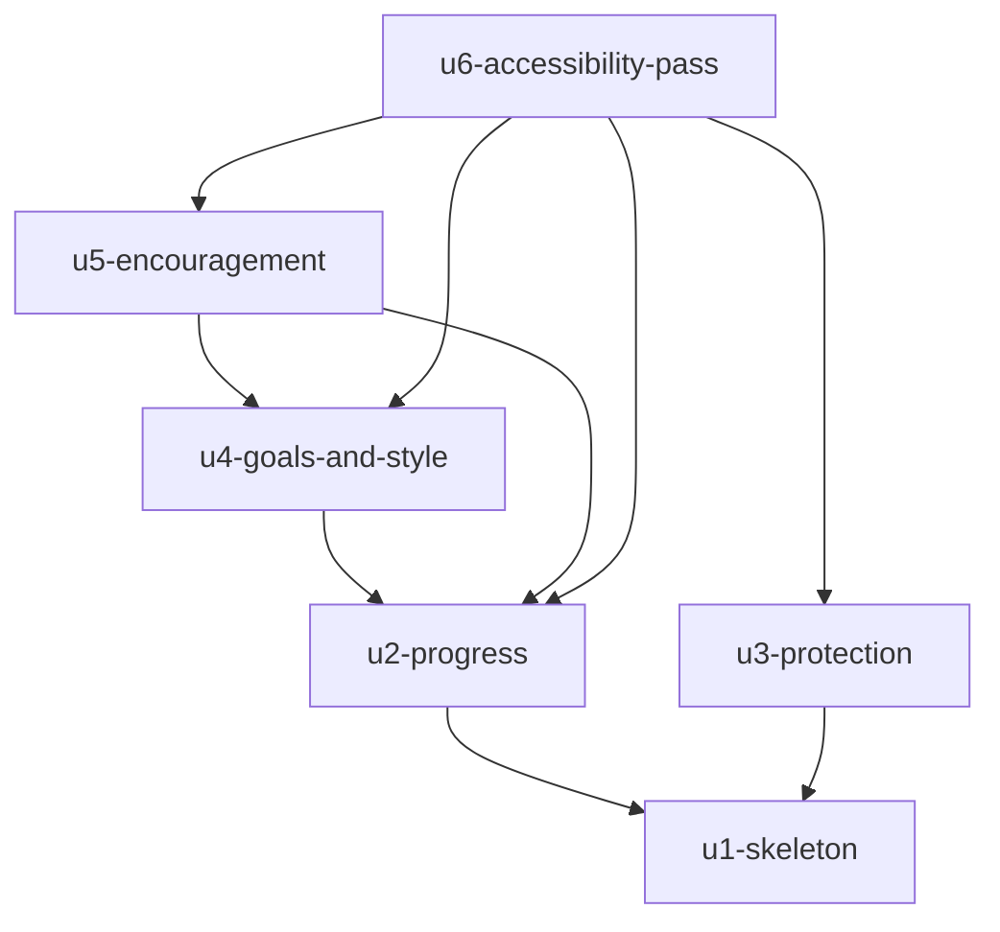

# Unit Dependency Graph — Learning Journey App

## Sources

- `components.md` — `aidlc/spaces/default/intents/261110-learning-journey-app/inception/domain-design/components.md`
- `decisions.md` — `aidlc/spaces/default/intents/261110-learning-journey-app/inception/domain-design/decisions.md`
- `requirements.md` — `aidlc/spaces/default/intents/261110-learning-journey-app/inception/requirements-analysis/requirements.md`
- `stories.md` — `aidlc/spaces/default/intents/261110-learning-journey-app/inception/user-stories/stories.md`
- `unit-of-work.md` in this folder, and the planning answers Q1 to Q5 in `units-generation-questions.md`

This document describes what can depend on what. It does not pick a build order or a critical path; Delivery Planning does that.

## Dependency Graph

A unit depends on every unit whose code its own code or tests need to build or pass. Units with no line between them can be built at the same time, each in its own copy of the project with none of the others' work in it.



<!-- Text fallback: Six units. u2 and u3 each depend on u1. u4 depends on u2. u5 depends on u2 and u4. u6 depends on u2, u3, u4 and u5. u1 depends on nothing. No cycles. -->

| Unit | Depends on | Why |
|---|---|---|
| u1-skeleton | none | It is the first working slice and builds the stack the others add to |
| u2-progress | u1-skeleton | Needs a saved journey, the stack and the journey page to mark stages on |
| u3-protection | u1-skeleton | Needs the generator and the store to put the cap, delete and replace around |
| u4-goals-and-style | u2-progress | The weekly pace uses the hours of stages not yet complete, and the goal line sits in the header u2 builds; the style choice reuses the generator from u1 |
| u5-encouragement | u2-progress, u4-goals-and-style | Milestones and the certificate need only progress (u2); the nudge needs progress and the goal date (u4). The unit depends on u4 as a whole because its nudge does |
| u6-accessibility-pass | u2-progress, u3-protection, u4-goals-and-style, u5-encouragement | It checks every screen and state those units add |

## Integration Points Between Units

| From | To | What crosses |
|---|---|---|
| u2-progress | u1-skeleton | The saved Journey record and the journey page; u2 adds partial updates to the same record |
| u3-protection | u1-skeleton | The generator calls the usage guard to reserve and release a slot; the store gains a delete; the web app gains dialogs |
| u4-goals-and-style | u2-progress | The goal date is a field on the same Journey record; the pace uses the progress rules |
| u4-goals-and-style | u1-skeleton | The style is passed to the generator, which already exists in u1 |
| u5-encouragement | u2-progress, u4-goals-and-style | Milestone, nudge and certificate rules read progress and goal data; the milestones shown are a field on the Journey record |
| u6-accessibility-pass | all UI units | Reads the screens the other units produced and edits them |

Shared data crossing the units is the one Journey record (ADR-003). The HTTP interface between the web app and the backend is defined in Contract Design, the next stage.

## Parallel Development Opportunities

- After u1, u2 and u3 have no dependency on each other.
- u3 and u4 have no dependency on each other.
- u5 needs both u2 and u4 but not u3. Within u5, milestones and the certificate need only u2; only the nudge needs the goal date from u4.
- u6 needs everything else.

Independent units that touch the same blocks (u2, u3 and u4 each change JourneyStore, JourneyGenerator or WebApp) will need their changes combined by hand when they are brought together, and merge conflicts in WebApp and JourneyStore are likely.

Several orderings are valid; Delivery Planning chooses one. Because there is one builder, parallel opportunities matter only if work is split across sessions or sources.

## First Unit and the Walking Skeleton

u1-skeleton is the only unit with no dependencies and is the integrated slice the team practices require first. It can run before the later units because it does not need progress, goals, limits, milestones or the style choice: it stands up the stack, makes a journey with a fallback, saves it, and shows it. The later units add to the same stack and the same journey record.

## Machine-Readable Edge Block

```yaml
units:
  - name: u1-skeleton
    kind: service
    depends_on: []
  - name: u2-progress
    kind: service
    depends_on: [u1-skeleton]
  - name: u3-protection
    kind: service
    depends_on: [u1-skeleton]
  - name: u4-goals-and-style
    kind: ui
    depends_on: [u2-progress]
  - name: u5-encouragement
    kind: ui
    depends_on: [u2-progress, u4-goals-and-style]
  - name: u6-accessibility-pass
    kind: ui
    depends_on: [u2-progress, u3-protection, u4-goals-and-style, u5-encouragement]
```

## Assumptions & Open Questions

- [assumption] "Builds or passes" is judged on code and tests: for example u4's tests need u2's progress rules, so u4 depends on u2 even though the two could be designed independently.
- [assumption] u3 does not depend on u2 because the cap, the delete and the dialogs act on the journey u1 already saves.
- None otherwise.
